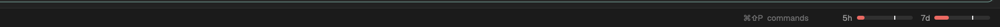

# herdr-claude-statusline

A [Herdr](https://herdr.dev) mod that shows Claude Code's 5h and 7d usage bars in the bottom bar.



Each bar has a fill for usage and a 2px marker for an even pace. Green, yellow and red come from claude-statusline, so Herdr agrees with your terminal status line. The mod computes nothing itself.

## Requirements

- [claude-statusline](https://github.com/PaddleHQ/claude-statusline) 0.16.0 or later. That is the first release with `rate-bars --data`.
- Herdr with `herdr-app` on your `PATH`.

## Install

1. Copy the mod:

   ```sh
   cp -R mods/claude-statusline ~/.config/herdr-app/mods/
   ```

2. Clone the main layout:

   ```sh
   herdr-app do layout.clone '{"name":"main","as":"main-usage"}'
   ```

3. In `~/.config/herdr-app/layouts/main-usage.json`, replace the `status` block with:

   ```json
   { "id": "status", "type": "row", "size": { "px": 28 }, "children": [
     { "id": "status-main", "type": "block", "content": { "mod": "workspace-status" } },
     { "id": "status-usage", "type": "block", "size": { "px": 260 },
       "content": { "mod": "claude-statusline" } } ] }
   ```

4. Switch to it with `layout.switch` or `ctrl-shift-l`.

The bars sit at the far right of the bottom bar, after Herdr's own items.

## Finding the binary

The mod uses the first of these that exists:

1. The `binary` prop on the block: `"props": {"binary": "/path/to/claude-statusline"}`.
2. `$CLAUDE_CONFIG_DIR/plugins/data/statusline-claude-statusline/bin/claude-statusline`
3. `$CLAUDE_CONFIG_DIR/claude-statusline/claude-statusline`
4. `claude-statusline` on `PATH`

`CLAUDE_CONFIG_DIR` defaults to `~/.claude`. On macOS, Herdr gets it from launchd.

## Good to know

- The bars refresh every 60 seconds and whenever claude-statusline's cache changes.
- If the binary is missing or too old, the bars show empty and the tooltip says why. They recover on their own once a working binary appears.
- Light usage early in a window shows red. That matches the terminal status line.

More in [RECIPE.md](RECIPE.md) and [docs/architecture/](docs/architecture/overview.md).

## Development

```sh
mise install
prek install
mise run test
mise run check
```
