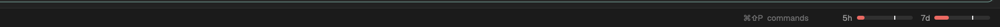

# claude-statusline

Two small usage bars at the right end of Herdr's bottom bar: `5h` and `7d`, for Claude Code's rate limits. Each bar shows how much of the window you have used, with a thin marker for where an even pace would be. The numbers come from claude-statusline, so they match the terminal status line.



## What you see

- A 260px block at the far right of the 28px bottom row, beside the stock `workspace-status` bar.
- Background `t.chrome`, a 1px top border in `t.border`, 14px side padding, text 11.8px in `t.muted`. Content is right-aligned.
- `5h [bar]` then `7d [bar]`, 12px apart. Each label sits 6px left of its bar.
- A bar is 80px wide, 6px high, rounded 3px, track in `t.border`.
- The fill is `used`% of the track. The marker is a 2px line in `t.foreground` at `target`% (capped at 97.5% so it stays inside the track).

## How it behaves

- Colour by `state`: `good` is `t.done`, `warn` is `t.ansi3`, `bad` is `t.blocked`. Being far under pace is also `bad`, the same as in the terminal.
- No reading (`ok: false`): empty track, no marker.
- Hover a bar for a tooltip: `5h: 8% used, pace 54%, resets 18:30`. A reset more than a day away is shown as `Mon 18:30`. With no reading it says `5h: no reading`.
- If claude-statusline is missing or fails, both bars are empty and the tooltip carries the reason, for example `claude-statusline failed (exit 2): ...`.
- Refresh: once at start, again when anything changes in the binary's `cache/` folder, and every 60 seconds. The bars recover on their own once a working binary appears.
- Nothing is clickable. There are no keys.

## Built from

- Mod `claude-statusline`, `mod.json` is `{ "place": "none" }`. Files: `main.js` (view), `core.js` (pure helpers: parsing, colours, tooltip text, binary lookup).
- Layout: a clone of `main` where the `status` block becomes a row. The stock mod keeps working beside ours.

```json
{ "id": "status", "type": "row", "size": { "px": 28 }, "children": [
  { "id": "status-main", "type": "block", "content": { "mod": "workspace-status" } },
  { "id": "status-usage", "type": "block", "size": { "px": 260 },
    "content": { "mod": "claude-statusline" } } ] }
```

- Optional prop on `status-usage`: `"props": {"binary": "/path/to/claude-statusline"}`.
- Data: it runs `claude-statusline rate-bars --data` (version 0.16.0 or later). One JSON line on stdout, exit 0:

```json
{"rate5h":{"ok":true,"used":75,"target":50,"state":"warn","resets_at":1760009000},
 "rate7d":{"ok":false}}
```

- Binary lookup, first hit wins (`CLAUDE_CONFIG_DIR` defaults to `~/.claude`): the `binary` prop; `$CLAUDE_CONFIG_DIR/plugins/data/statusline-claude-statusline/bin/claude-statusline`; `$CLAUDE_CONFIG_DIR/claude-statusline/claude-statusline`; `claude-statusline` on `PATH`.
- `herdr` calls: `exec` (find and run the binary, read `CLAUDE_CONFIG_DIR`), `watchFolder` on `<state dir>/cache`, `cx.timer.every(60000)`, `props`, `theme`, `home`, `checking`. The state dir is the plugin data dir for lookup 2, otherwise `$CLAUDE_CONFIG_DIR/claude-statusline`.
- Runs programs: `sh`, `test` and the claude-statusline binary. No network. Reads only the claude-statusline cache folder, through the binary.

## Watch out

- Under pace shows red. `bad` covers both far over and far under pace, so light use early in a window paints the bar red. This follows the terminal status line.
- `ok` flips to `false` when a window resets, without any cache write. That is why the 60 second timer exists. Without it the bar keeps showing the old window.
- A claude-statusline without `--data` (0.15.0 and earlier) exits 2. The bars show empty with the failure in the tooltip.
- After a failed run or a changed `binary` prop, the mod looks the binary up again on the next refresh.
- The block sits after the palette hint and cannot go between Herdr's own items.
- It copies the stock bar's look. If Herdr restyles `workspace-status`, adjust the colours and border to match.
- Herdr's GUI gets `CLAUDE_CONFIG_DIR` from launchd. Set it there, or use the `binary` prop.
- `t.ansi3` is the theme's ansi yellow.

## Done when

- `herdr-app check mods/claude-statusline` passes.
- With a working claude-statusline, `5h` and `7d` show a fill and a 2px marker, coloured by `state`.
- Hovering a bar shows used, pace and reset time.
- With the binary missing or too old, the bars are empty and the tooltip says why. They fill in without a restart once a working binary exists.
- Touching a file in the binary's `cache/` folder refreshes the bars.
